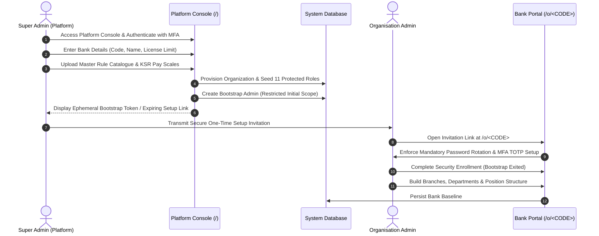
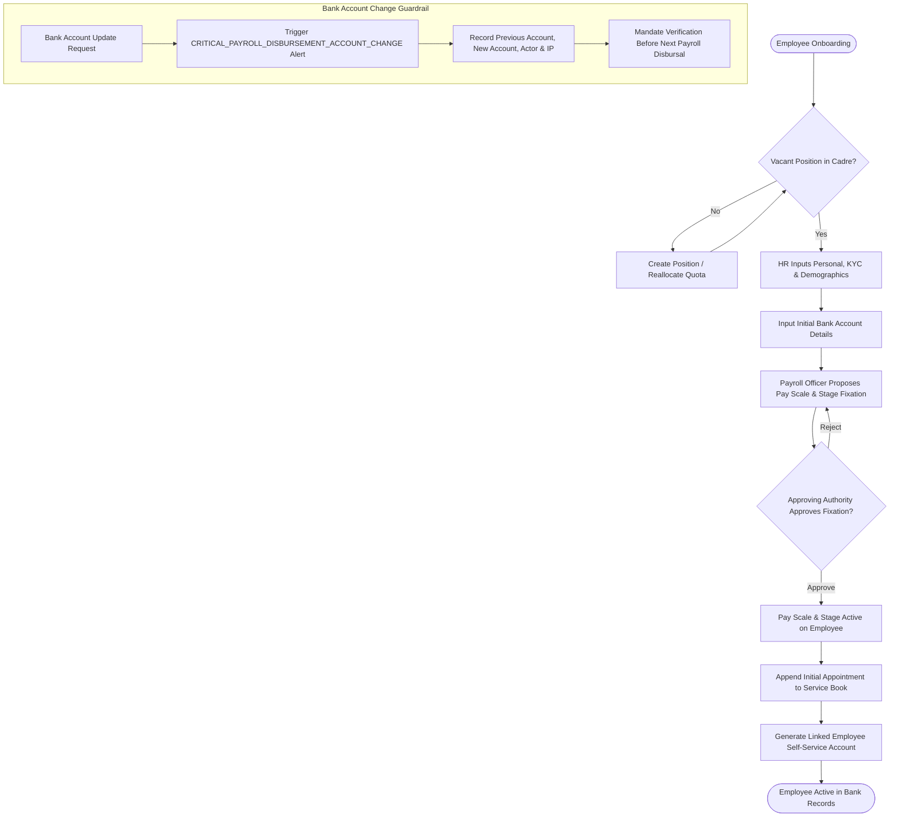
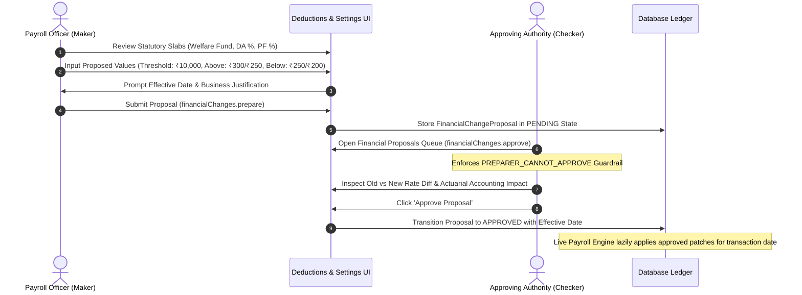
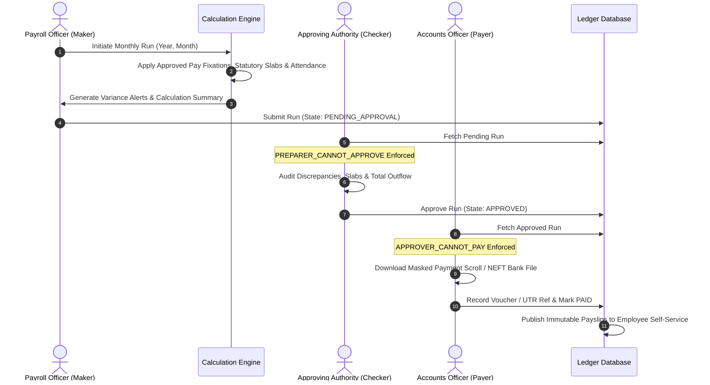
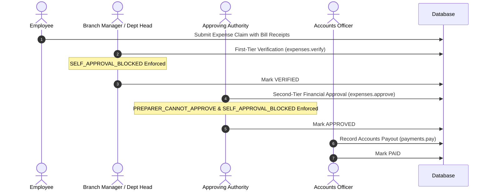
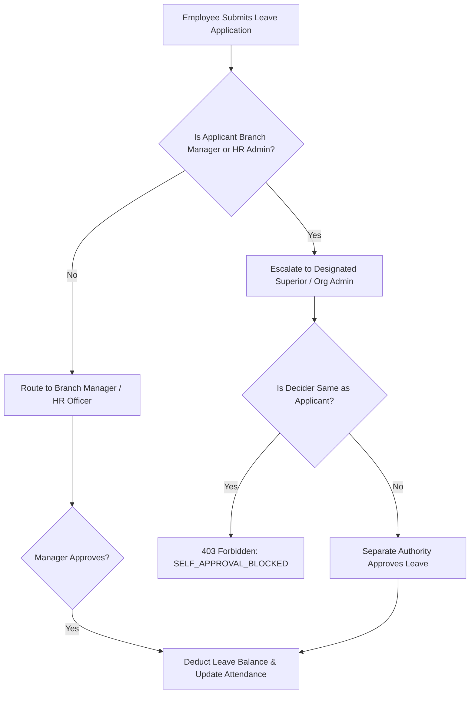
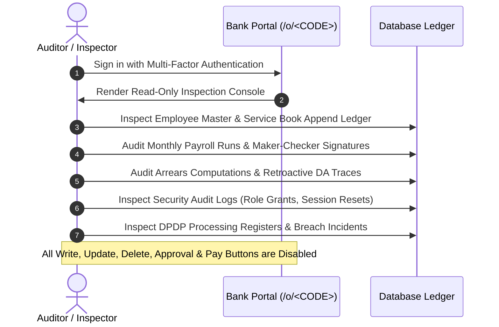

# UCB-HRMS Solutions: Application Features, Roles, Permissions & User Flows

**Document Version:** 2.0.0 (Hardened & Audit-Ready)  
**Effective Date:** 23 November 2026  
**System Target:** Urban Co-operative Banks (UCBs) & Co-operative Credit Societies  
**Regulatory Framework:** Kerala Service Rules (KSR), Kerala Co-operative Societies Act & Rules, Digital Personal Data Protection Act, 2023 (DPDP Act)

---

## 1. Executive Summary & Architecture Overview

UCB-HRMS is an enterprise-grade, multi-tenant Human Resource Management and Payroll calculation platform specifically engineered for Urban Co-operative Banks (UCBs) operating under the Kerala Service Rules (KSR) framework.

### 1.1 Dual-Surface Multi-Tenant Model
The application operates on two strictly separated operational surfaces:
1. **Platform Administration (`/`):** Operated exclusively by platform vendor engineers (`SUPER_ADMIN`). Oversees tenant licensing, bank onboarding, global statutory rule catalogues, platform security parameters, and cross-bank health monitoring. Platform administrators are strictly excluded from tenant employee identities, Service Books, and payroll calculation records.
2. **Tenant Banking Portal (`/o/<BANK_CODE>`):** Operated independently by authorized bank personnel. Each bank environment maintains dedicated tenant isolation, distinct branding, isolated general ledgers, independent organizational hierarchies, and dedicated security audit logs.

### 1.2 Tenant Isolation Architecture (Shared Schema with Scoped Predicates)
* **Scoped Predicates:** Tenancy is enforced via a shared-database schema where every query is bound to `organization_id == req.user.organizationId` through the `scopedWhere` access control engine.
* **RLS & Application-Level Defense in Depth:** In addition to route-level tenant validation (`authenticate` and `requirePermission`), all database transactions and service methods enforce active-status checks and organizational tenancy boundaries. Cross-tenant IDs return uniform 404 responses to prevent tenant enumeration attacks.
* **Access Version Token Invalidation:** Every user record carries an integer `accessVersion`. Any assignment modification, role removal, credential change, or employee unlinking increments `accessVersion`, immediately invalidating active JWTs across web and mobile clients.

### 1.3 Core Architectural Principles
* **Configuration Over Code:** All establishment scales, Kerala statutory DA revisions, welfare fund slabs, pay fixation formulas, and increment rules are driven by data records, never hard-coded.
* **Separation of Duties (Maker-Checker-Payer):** Financial workflows strictly isolate the transaction preparer (`PAYROLL_OFFICER`), approver (`APPROVING_AUTHORITY`), and disburser (`ACCOUNTS_OFFICER`). Assignment-time mutual exclusion prevents assigning conflicting financial roles to the same user.
* **Effective Access & Scope Union:** User capabilities are determined by the union of assigned roles, scoped strictly to the whole organization (`ORGANISATION`), selected operational branches (`SELECTED_BRANCHES`), assigned departments (`DEPARTMENT`), or individual own records (`OWN`).
* **Auditability & Immutable Timelines:** All employee compensation history, service book entries, and statutory setting changes append immutable records with user identification, client IP, timestamp, and before/after state diffs.

---

## 2. Complete Application Features Matrix

| Module ID | Module Name | Core Capabilities & Business Functions | Regulatory / Technical Triggers |
| :--- | :--- | :--- | :--- |
| **MOD-01** | **Multi-Tenant Administration** | Bank onboarding, domain routing (`/o/<CODE>`), license lifecycle (Active/Suspended/Grace), branding customization (bank logo, accent colors, favicon). | Tenant Isolation Middleware, JWT Session Validation. |
| **MOD-02** | **Organizational Structure** | Multi-branch management, hierarchical departments, position capacity quotas, position-to-cadre linkage, operational responsibilities (e.g., Branch Manager). | Position capacity enforcement, effective-dated occupancy. |
| **MOD-03** | **Establishment & Cadres** | Post cadre definitions, pay revision registers, government pay scales, pay stage ladders, increment policies, higher grade progression rules. | Kerala Service Rules (KSR), Government Orders (GO). |
| **MOD-04** | **Employee Lifecycle & Service Book** | Comprehensive employee records, digital append-only Service Book, promotion history, transfer orders, document attachments, qualification records, bank account guardrails. | KSR Part I & II Service Book compliance. |
| **MOD-05** | **Monthly Payroll Engine** | Automated salary calculation, attendance integration, statutory Kerala Welfare Fund deduction slabs (Basic + DA threshold), HRA tiers, PF/VPF, GSLI, Professional Tax. | Live calculation simulator, pre-run discrepancy audit. |
| **MOD-06** | **DA Revision & Arrears Engine** | Retroactive Government Order processing, historical month-by-month pay scale recomputation, differential arrears calculation, multi-instalment disbursement. | GO DA Orders, split instalment schedules. |
| **MOD-07** | **Staff Advances & Overdraft** | Festival advance disbursements, festival advance repayment windows, strict salary-bracket overdraft tiers, automated monthly recovery deduction lines. | Advances lifecycle, overdraft slab evaluation. |
| **MOD-08** | **Allowances & Custom Deductions** | Flat and percentage-based allowances/deductions, recurring societies, LIC recoveries, vehicle loan recoveries, medical allowances, stagnation increments. | Automated slip injection, post-level applicability. |
| **MOD-09** | **Leave & Attendance Tracking** | Statutory leave categories (Casual, Earned, Half Pay, Commuted, Maternity), leave credit rules, biometric/geofenced mobile check-in, attendance reconciliation, self-approval blocking. | Branch geofencing, KSR leave credit rules, `SELF_APPROVAL_BLOCKED`. |
| **MOD-10** | **Expense Claims & Reimbursements** | Digital expense claim filing, receipt attachments (PDF/Images), two-tier approval workflow (`expenses.verify` by Manager $\rightarrow$ `expenses.approve` by Approving Authority), accounts disbursement. | Two-tier dual control, non-payroll accounting entries. |
| **MOD-11** | **Financial Year-End Closure** | Comprehensive financial year closing, leave encashment/carry-forward validation, Form 16 compilation, fiscal ledger sealing. | Annual accounting closure, irreversible year lock. |
| **MOD-12** | **DPDP Act, 2023 Compliance** | Digital Personal Data Protection suite: Processing activity registers, consent management, automated service-mediated data disclosures, incident management, retention proposals. | DPDP Act statutory compliance, DPO audit desk. |
| **MOD-13** | **Independent Regulatory Audit** | Read-only inspection across all employee records, service books, payroll archives, arrears cases, access logs, and privacy registers. Barred from all write operations. | Statutory inspection & external audit compliance. |
| **MOD-14** | **Mobile Self-Service & Device Pairing** | Expo React Native app, QR-code cryptographic device link, biometric app lock, passbook-styled payslip viewer, offline security, geofenced mobile attendance. | AES-256 secure enclave tokens, QR expiring session. |

---

## 3. User Roles, Personas & Separation of Duties Architecture

Rather than a hierarchical top-down pyramid, roles in UCB-HRMS are structured into **Functional Responsibility Clusters** with strict lateral boundaries:

```
                            [ PLATFORM GOVERNANCE ]
                                       │
                              SUPER_ADMINISTRATOR
                                       │
         ─────────────────────────────────────────────────────────────
         │                                                           │
         ▼                                                           ▼
[ TENANT GOVERNANCE & AUDIT ]                               [ DATA PRIVACY DESK ]
  ORGANISATION_ADMIN                                         DATA_PROTECTION_OFFICER
  AUDITOR (Read-Only Inspector)                                      │
         │                                                           │
         ├─────────────────────────────┬─────────────────────────────┤
         ▼                             ▼                             ▼
[ PEOPLE & OPERATIONS CLUSTER ]  [ LINE MANAGEMENT CLUSTER ]   [ FINANCIAL EXECUTION TRIAD ]
  HR_ADMIN (Org-wide)              BRANCH_MANAGER (Branch)       PAYROLL_OFFICER (Maker)
  HR_OFFICER (Branch-scoped)       DEPARTMENT_HEAD (Dept)                     │ (No self-approval)
                                                                              ▼
                                                                 APPROVING_AUTHORITY (Checker)
                                                                              │ (No self-payment)
                                                                              ▼
                                                                 ACCOUNTS_OFFICER (Payer)
         │                             │                             │
         └─────────────────────────────┴─────────────────────────────┘
                                       │
                                       ▼
                             [ SELF-SERVICE DOMAIN ]
                             EMPLOYEE (Own Records)
```

### 3.1 Role Persona Descriptions

#### 1. SUPER_ADMIN (Platform Administrator)
* **Scope:** Global Platform (`/`).
* **Objective:** Operates platform-wide infrastructure, provisions new banks, configures tenant licensing, maintains master Bank Rule Catalogues, and monitors platform health.
* **Restrictions:** Strictly excluded from viewing individual employee profiles, Service Books, or payroll records of any bank.

#### 2. ORGANISATION_ADMIN (Tenant Administrator)
* **Scope:** Bank Organisation (`ORGANISATION`).
* **Objective:** Full administrative control over tenant structures. Configures branches, departments, position quotas, role assignments, system preferences, mandatory fields, and audit reviews.
* **Restrictions:** Cannot prepare, approve, or disburse payroll runs, financial proposals, or arrears cases.

#### 3. AUDITOR (Independent Regulatory Inspector)
* **Scope:** Bank Organisation (`ORGANISATION`).
* **Objective:** Independent read-only audit and compliance inspection over bank data, historical transactions, access logs, Service Books, and privacy registers.
* **Restrictions:** Strictly read-only; barred from all create, update, delete, approval, payment, or configuration actions. Mutually exclusive with all administrative, financial, and compliance roles.

#### 4. HR_ADMIN (Human Resources Administrator)
* **Scope:** Bank Organisation (`ORGANISATION`).
* **Objective:** Manages bank-wide employee establishment, onboarding records, cadre assignments, promotion records, transfer orders, leave policies, and Service Books.
* **Restrictions:** No financial preparation or disbursement authority. Pay fixations require checker approval.

#### 5. HR_OFFICER (Human Resources Officer)
* **Scope:** Assigned Branches (`SELECTED_BRANCHES`).
* **Objective:** Manages day-to-day employee documentation, leave processing, attendance reconciliation, and service records for staff stationed within assigned branches.
* **Restrictions:** Cannot access records outside assigned branch scope; no financial execution authority.

#### 6. BRANCH_MANAGER (Branch Operations Head)
* **Scope:** Assigned Branch (`SELECTED_BRANCHES`).
* **Objective:** Approves staff leave applications, oversees branch attendance, verifies branch expense claims (`expenses.verify`), and manages geofence coordinates.
* **Restrictions:** Subject to `SELF_APPROVAL_BLOCKED` for own leave and expense claims. Actions strictly limited to staff currently assigned to the designated branch.

#### 7. DEPARTMENT_HEAD (Department Head)
* **Scope:** Assigned Department (`DEPARTMENT`).
* **Objective:** Supervises departmental staff, reviews departmental leave patterns, monitors operational attendance, and verifies departmental expense claims (`expenses.verify`).
* **Restrictions:** Read-only departmental oversight; no default final financial approval authority.

#### 8. PAYROLL_OFFICER (Financial Maker / Preparer)
* **Scope:** Bank Organisation (`ORGANISATION`).
* **Objective:** Prepares monthly payroll runs, compiles retroactive DA arrears cases, formulates financial change proposals (pay fixations, statutory rule revisions), and prepares staff advance proposals.
* **Restrictions:** Cannot approve or pay transactions (`PREPARER_CANNOT_APPROVE`, `PREPARER_CANNOT_PAY`).

#### 9. APPROVING_AUTHORITY (Financial Checker / Approver)
* **Scope:** Bank Organisation (`ORGANISATION`).
* **Objective:** Formally reviews, audits, and approves or rejects financial change proposals, monthly payroll calculations, retroactive arrears distributions, staff advances, year-end closures, and employee expense claims.
* **Restrictions:** Cannot prepare calculations or disburse payments (`APPROVER_CANNOT_PAY`, `PREPARER_CANNOT_APPROVE`).

#### 10. ACCOUNTS_OFFICER (Disbursing Officer / Payer)
* **Scope:** Bank Organisation (`ORGANISATION`).
* **Objective:** Processes approved payroll batches, executes payment file exports, records transaction reference numbers / voucher numbers, and processes arrears disbursements.
* **Restrictions:** Operates with masked payment accounts; cannot prepare or approve transactions (`PREPARER_CANNOT_PAY`, `APPROVER_CANNOT_PAY`).

#### 11. DATA_PROTECTION_OFFICER (DPDP Officer)
* **Scope:** Bank Organisation (`ORGANISATION`).
* **Objective:** Ensures compliance with the Digital Personal Data Protection Act, 2023. Manages RoPA, handles statutory employee data rights requests (Access, Correction, Erasure, Nomination), and logs security incidents.
* **Restrictions:** Disclosures are mediated via automated service reports; cannot perform financial actions or administrative user provisioning. Mutually exclusive with financial, administrative, and auditor roles.

#### 12. EMPLOYEE (Staff Self-Service)
* **Scope:** Individual Records (`OWN`).
* **Objective:** Views personalized salary passbook and downloadable payslips, tracks leave balances, submits leave applications, records geofenced mobile attendance check-ins, files expense claims, acknowledges bank policies, and exercises DPDP privacy rights.
* **Restrictions:** Strictly limited to own records; cannot view peer records or systemic configurations.

---

### 3.2 Mutually Exclusive Role Matrix (Assignment-Time Separation of Duties)

To eliminate financial fraud paths and audit non-compliance, UCB-HRMS enforces **assignment-time mutual exclusion**. An administrator cannot assign conflicting roles to the same user account:

| Role Assignment Candidate | Mutually Exclusive With | Enforcement Rationale |
| :--- | :--- | :--- |
| **`PAYROLL_OFFICER`** | `APPROVING_AUTHORITY`, `ACCOUNTS_OFFICER`, `DATA_PROTECTION_OFFICER`, `AUDITOR` | Prevents preparation/approval/payment concentration of financial powers; ensures independence. |
| **`APPROVING_AUTHORITY`** | `PAYROLL_OFFICER`, `ACCOUNTS_OFFICER`, `DATA_PROTECTION_OFFICER`, `AUDITOR` | Prevents approver from disbursing funds or inspecting their own approvals as an auditor. |
| **`ACCOUNTS_OFFICER`** | `PAYROLL_OFFICER`, `APPROVING_AUTHORITY`, `DATA_PROTECTION_OFFICER`, `AUDITOR` | Prevents payment officer from preparing payroll or auditing financial disbursements. |
| **`DATA_PROTECTION_OFFICER`** | `ORGANISATION_ADMIN`, `PAYROLL_OFFICER`, `APPROVING_AUTHORITY`, `ACCOUNTS_OFFICER`, `AUDITOR` | Ensures statutory privacy officer is completely independent of executive management and finance. |
| **`AUDITOR`** | `ORGANISATION_ADMIN`, `HR_ADMIN`, `HR_OFFICER`, `PAYROLL_OFFICER`, `APPROVING_AUTHORITY`, `ACCOUNTS_OFFICER`, `DATA_PROTECTION_OFFICER` | Guarantees regulatory auditor independence; an auditor cannot audit records they had power to modify. |

**Assignment Enforcement Rules:**
1. **Assignment-Time Validation:** Attempting to assign a mutually exclusive role returns an immediate `409 Conflict` (`MUTUALLY_EXCLUSIVE_ROLES_DETECTED`).
2. **Self-Assignment Guard:** An administrator cannot grant, modify, or extend role assignments to their own user account.
3. **Activation Gate:** The tenant cannot activate `PERMISSIONS` access control mode if any active user holds mutually exclusive roles.

---

## 4. Data Permissions, Scopes & Guardrail Architecture

The security model is governed by an effective-access permission engine. Permissions comprise a module, an action, permitted scopes, and security guardrails.

### 4.1 Permitted Scopes
1. **`OWN`:** Strict predicate matching `employee_id == req.user.employeeId`.
2. **`DEPARTMENT`:** Filtered where the target employee belongs to the user's assigned departments.
3. **`SELECTED_BRANCHES`:** Filtered where the target employee belongs to the user's explicitly assigned branches.
4. **`ORGANISATION`:** Tenant-wide access bounded strictly by `organization_id == req.user.organizationId`.

### 4.2 Security Guardrails
* **`PREPARER_CANNOT_APPROVE`:** The identity who created or calculated a payroll run, arrears case, financial proposal, or compensation assignment is blocked from approving it.
* **`PREPARER_CANNOT_PAY` & `APPROVER_CANNOT_PAY`:** The identity who prepared or approved a financial transaction cannot disburse or record its payment.
* **`SELF_APPROVAL_BLOCKED`:** Users (including Branch Managers and HR Admins) cannot approve their own leave applications or verify/approve their own expense claims. The system forces routing to a designated superior or independent authority.
* **`MASKED_PAYMENT_DATA`:** Obfuscates core bank account details for operational screens while retaining auditability.

---

## 5. Complete Role-to-Permission Mapping Matrix

| Permission Code | Risk Level | ORG ADMIN | HR ADMIN | HR OFCR | PAYROLL OFCR | APPROV AUTH | ACCOUNTS OFCR | BRANCH MGR | DEPT HEAD | DPO | AUDITOR | EMPLOYEE |
| :--- | :---: | :---: | :---: | :---: | :---: | :---: | :---: | :---: | :---: | :---: | :---: | :---: |
| **`structure.view` / `manage`** | WRITE | Manage | View | — | — | — | — | — | — | — | View | — |
| **`branches.view` / `manage`** | WRITE | Manage | View | — | — | — | — | View | — | — | View | — |
| **`departments.view` / `manage`**| WRITE | Manage | Manage | — | — | — | — | — | View | — | View | — |
| **`positions.view` / `manage`** | WRITE | Manage | View | — | — | — | — | — | — | — | View | — |
| **`transfers.view` / `manage`** | WRITE | Manage | Manage | — | — | — | — | — | — | — | — | — |
| **`people.view`** | READ | Org | Org | Branches | — | — | — | Branch | Dept | — | Org | — |
| **`people.create` / `edit`** | WRITE | Manage | Manage | Branches | — | — | — | — | — | — | — | — |
| **`people.export`** | WRITE | Org | Org | Branches | — | — | — | — | — | — | — | — |
| **`hr.view` / `manage`** | WRITE | Manage | Manage | Branches | — | — | — | — | — | — | View | — |
| **`leave.view`** | READ | Org | Org | Branches | — | — | — | Branch | Dept | — | — | Own |
| **`leave.manage`** | WRITE | Manage | Manage | Branches | — | — | — | — | — | — | — | — |
| **`leave.approve`** *(Self-Block)*| WRITE | — | Manage | Branches | — | — | — | Branch | — | — | — | — |
| **`attendance.view`** | READ | Org | Org | Branches | Org | — | — | Branch | Dept | — | — | Own |
| **`attendance.manage`** | WRITE | Manage | Manage | Branches | — | — | — | Branch | — | — | — | — |
| **`documents.view` / `manage`** | WRITE | Manage | Manage | Branches | — | — | — | — | — | — | — | Own |
| **`payroll.view`** | READ | Org | — | — | Org | Org | Org | — | — | — | Org | — |
| **`payroll.prepare`** | FINANCIAL | — | — | — | Org | — | — | — | — | — | — | — |
| **`payroll.approve`** | FINANCIAL | — | — | — | — | Org | — | — | — | — | — | — |
| **`payroll.export`** | WRITE | — | — | — | Org | — | Org | — | — | — | — | — |
| **`arrears.view`** | READ | Org | — | — | Org | Org | — | — | — | — | Org | — |
| **`arrears.prepare`** | FINANCIAL | — | — | — | Org | — | — | — | — | — | — | — |
| **`arrears.approve`** | FINANCIAL | — | — | — | — | Org | — | — | — | — | — | — |
| **`arrears.pay`** | FINANCIAL | — | — | — | — | — | Org | — | — | — | — | — |
| **`advances.view`** | READ | Org | — | — | Org | Org | — | — | — | — | Org | — |
| **`advances.prepare`** | FINANCIAL | — | — | — | Org | — | — | — | — | — | — | — |
| **`advances.approve`** | FINANCIAL | — | — | — | — | Org | — | — | — | — | — | — |
| **`compensation.view`** | READ | Org | — | — | Org | Org | — | — | — | — | Org | — |
| **`compensation.prepare`** | FINANCIAL | — | — | — | Org | — | — | — | — | — | — | — |
| **`compensation.approve`** | FINANCIAL | — | — | — | — | Org | — | — | — | — | — | — |
| **`financialChanges.view`** | READ | Org | — | — | Org | Org | — | — | — | — | — | — |
| **`financialChanges.prepare`** | FINANCIAL | — | — | — | Org | — | — | — | — | — | — | — |
| **`financialChanges.approve`** | FINANCIAL | — | — | — | — | Org | — | — | — | — | — | — |
| **`expenses.view`** | READ | Org | — | — | — | Org | — | Branch | Dept | — | Org | Own |
| **`expenses.verify`** | FINANCIAL | — | — | — | — | — | — | Branch | Dept | — | — | — |
| **`expenses.approve`** | FINANCIAL | — | — | — | — | Org | — | — | — | — | — | — |
| **`payments.view`** | READ | Org | — | — | — | — | Org | — | — | — | Org | — |
| **`payments.pay`** | FINANCIAL | — | — | — | — | — | Org | — | — | — | — | — |
| **`yearend.view`** | READ | Org | — | — | — | Org | — | — | — | — | Org | — |
| **`yearend.close`** | WRITE | Org | — | — | — | Org | — | — | — | — | — | — |
| **`settings.view` / `configure`**| WRITE | Manage | — | — | — | — | — | — | — | — | View | — |
| **`roles.manage` / `users.manage`**| WRITE | Manage | — | — | — | — | — | — | — | — | — | — |
| **`audit.view`** | READ | Org | — | — | — | — | — | — | — | — | Org | — |
| **`chart.view`** | READ | Org | Org | Branches | Org | Org | Org | Branch | Dept | Org | Org | Branch+HO|
| **`geofence.view` / `manage`** | WRITE | Manage | — | — | — | — | — | Manage | — | — | — | — |
| **`dpdp.view` / `manage`** | WRITE | — | — | — | — | — | — | — | — | Manage | View | — |
| **`dpdp.sensitive.view`** | READ | Org | — | — | — | — | — | — | — | Org | Org | — |
| **`self.*`** | READ/WRITE| — | — | — | — | — | — | — | — | — | — | Own |

---

## 6. End-to-End Hardened User Flows

### Flow 1: Platform Setup & Bootstrap Credential Security
**Actors:** `SUPER_ADMIN` $\rightarrow$ `ORGANISATION_ADMIN`



**Security Details:**
* The bootstrap administrator cannot access payroll, salary registers, or employee profiles.
* Upon first password rotation and initial employee link, the user permanently transitions from bootstrap state to a standard `ORGANISATION_ADMIN`.

---

### Flow 2: Employee Lifecycle, Pay Fixation Dual Control & Bank Guardrails
**Actors:** `HR_ADMIN` / `HR_OFFICER` $\rightarrow$ `PAYROLL_OFFICER` (Maker) $\rightarrow$ `APPROVING_AUTHORITY` (Checker)



**Hardened Controls:**
1. **Pay Fixation Maker-Checker:** In `PERMISSIONS` mode, HR administrators cannot unilaterally fix an employee's salary stage or scale. Initial compensation must be proposed (`compensation.prepare`) and formally approved (`compensation.approve`) by the Approving Authority before payroll can run.
2. **Bank Account Fraud Guard:** Direct modification of payroll bank account numbers triggers an immutable high-priority audit event (`CRITICAL_PAYROLL_DISBURSEMENT_ACCOUNT_CHANGE`), tracking both previous and new account numbers, and alerting the Approving Authority before payroll disbursement.

---

### Flow 3: Kerala Welfare Fund & Statutory Settings Dual Control Flow
**Actors:** `PAYROLL_OFFICER` (Maker) $\rightarrow$ `APPROVING_AUTHORITY` (Checker)



**Hardened Controls:**
* In `PERMISSIONS` mode, direct PUT modifications to `/settings/payroll` are blocked with `409 Conflict`.
* All rate changes (DA rates, Kerala Welfare Fund slabs, GSLI, PF) must be submitted via `FinancialChangeProposal` with an effective date and verified by the Approving Authority.

---

### Flow 4: Monthly Payroll Maker-Checker-Payer Execution Flow
**Actors:** `PAYROLL_OFFICER` (Maker) $\rightarrow$ `APPROVING_AUTHORITY` (Checker) $\rightarrow$ `ACCOUNTS_OFFICER` (Payer)



**Guardrails Enforced:**
* `PREPARER_CANNOT_APPROVE`: The user who prepared the run cannot approve it.
* `APPROVER_CANNOT_PAY`: The user who approved the run cannot disburse it.
* `PREPARER_CANNOT_PAY`: The preparer cannot disburse funds.

---

### Flow 5: Two-Tier Expense Claims & Reimbursements Flow
**Actors:** `EMPLOYEE` $\rightarrow$ `BRANCH_MANAGER` / `DEPARTMENT_HEAD` $\rightarrow$ `APPROVING_AUTHORITY` $\rightarrow$ `ACCOUNTS_OFFICER`



---

### Flow 6: Leave Self-Approval Guardrail & Escalation Flow
**Actors:** `EMPLOYEE` / `BRANCH_MANAGER` $\rightarrow$ Designated Approver



**Security Details:**
* Under `SELF_APPROVAL_BLOCKED`, a Branch Manager or HR Administrator attempting to approve their own leave application receives an immediate `403 Forbidden`.
* Self-applications must be approved by an authorized superior.

---

### Flow 7: DPDP Act 2023 Automated Service-Mediated Disclosure Flow
**Actors:** `EMPLOYEE` (Data Principal) $\rightarrow$ `DATA_PROTECTION_OFFICER`

```mermaid
sequenceDiagram
    autonumber
    actor E as Employee (Data Principal)
    actor DPO as Data Protection Officer
    participant SVC as Automated Privacy Engine
    participant DB as Encrypted Storage

    E->>DB: Submit Right of Access Request (DPDP Act, 2023)
    DB->>DPO: Notify DPO & Start Statutory SLA Countdown
    DPO->>SVC: Trigger Data Principal Disclosure Report
    Note over DPO,SVC: DPO has no raw database access; reports are generated by service
    SVC->>DB: Compile Personal Data, Processing Purposes & Consents
    SVC-->>E: Deliver Digitally Signed Data Disclosure Dossier
    DPO->>DB: Record Resolution & Append Statutory RoPA Audit
```

---

### Flow 8: Independent Regulatory Audit & Compliance Inspection Flow
**Actors:** `AUDITOR`



---

## 7. Data Integrity, Validation & Security Controls

### 7.1 Monetary Precision & Currency Integrity
* **Rupee Rounding Standards:** In compliance with Indian banking standards, all allowance line items, gross salaries, net payables, arrears differentials, and deduction sums round half-up to the nearest whole rupee (`₹1.00`).
* **Percentage Precision:** Interest percentages, DA rates, and PF contribution rates maintain floating-point precision up to 3 decimal places (e.g., `17.125%`).

### 7.2 Session Lifecycle & Device Invalidation
* **JWT Access Invalidation:** Every web session and mobile token embeds an integer `accessVersion`. When an administrator adjusts role assignments, reassigns branch scopes, or changes account credentials, the user's `accessVersion` increments, immediately invalidating active tokens across all web browsers and linked mobile devices.
* **Biometric Mobile Security:** Mobile device refresh tokens are stored in the device's native hardware keystore / keychain with mandatory local biometric verification (Fingerprint / Face ID).

---

## 8. Summary Checklist for System & Compliance Auditors

1. **Assignment-Time Separation of Duties:** Verify that no individual user account holds mutually exclusive role pairings (e.g., `PAYROLL_OFFICER` + `APPROVING_AUTHORITY` or `APPROVING_AUTHORITY` + `ACCOUNTS_OFFICER`).
2. **Transaction Maker-Checker:** Verify that transactions prepared by an identity cannot be approved or paid by the same identity (`PREPARER_CANNOT_APPROVE`, `APPROVER_CANNOT_PAY`, `PREPARER_CANNOT_PAY`).
3. **Self-Approval Prohibition:** Confirm that `SELF_APPROVAL_BLOCKED` prevents branch managers and administrative staff from approving their own leave applications or expense claims.
4. **Statutory Settings Dual Control:** Verify that Dearness Allowance and Welfare Fund rate changes require formal proposal and separate approval with effective dates in `PERMISSIONS` mode.
5. **Bank Account Modification Audit:** Verify that updating salary disbursement account details generates an explicit high-severity security audit event with previous and new account tracking.
6. **Auditor Independence:** Confirm that user accounts with the `AUDITOR` role have strictly read-only access across all operational modules and cannot perform write or administrative actions.
7. **Mobile Privacy Enforcement:** Ensure that GPS coordinates evaluated during mobile attendance check-ins are processed in memory and discarded without permanent database storage.
